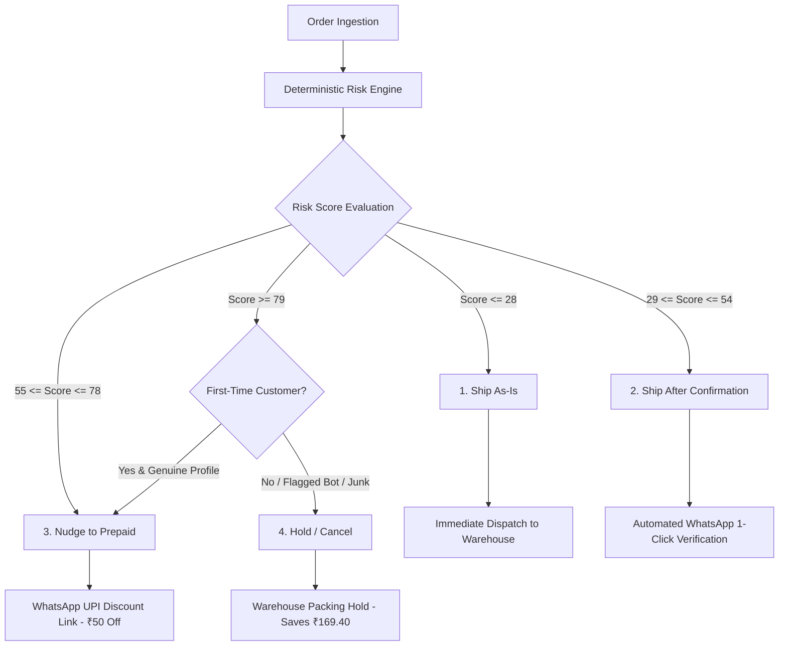

# AuraCare AI — Intelligent COD & RTO Decision Intelligence Platform

> **Oytra Associate Software Engineer Take-Home Assignment Solution**  
> A production-grade decision engine and financial analytics platform designed for direct-to-consumer (D2C) brands to predict Return-to-Origin (RTO) risk, automate WhatsApp customer verification, and optimize COD-to-prepaid conversion economics.

---

## Table of Contents

1. [Executive Overview](#1-executive-overview)
2. [Problem Statement and Business Context](#2-problem-statement-and-business-context)
3. [Solution Architecture and Decision Model](#3-solution-architecture-and-decision-model)
4. [Application Modules](#4-application-modules)
5. [Architecture and Technology Stack](#5-architecture-and-technology-stack)
6. [Financial Methodology and Unit Economics](#6-financial-methodology-and-unit-economics)
7. [Dataset and Analytical Findings](#7-dataset-and-analytical-findings)
8. [Installation and Execution](#8-installation-and-execution)
9. [Assignment Deliverables Matrix](#9-assignment-deliverables-matrix)
10. [Verification and Known Limitations](#10-verification-and-known-limitations)

---

## 1. Executive Overview

In the Indian D2C ecosystem, Cash on Delivery (COD) accounts for over 50% of GMV but introduces severe operational losses via Return-to-Origin (RTO). When a package returns undelivered, the merchant incurs non-refundable forward courier freight, reverse logistics freight, packaging wear, and inventory obsolescence.

**AuraCare AI** replaces blunt, blanket policies (such as blindly blacklisting pincodes or shipping every order without verification) with a four-tier automated intervention funnel. The system evaluates every order deterministically across geographical risk, customer history, basket composition, and address structure, augmented by server-side NLP for colloquial Indian address parsing.

---

## 2. Problem Statement and Business Context

The platform is parameterized around the benchmark unit economics of a growing Indian D2C brand:

| Metric | Baseline Value | Operational Impact |
| :--- | :--- | :--- |
| **Monthly Order Volume** | 3,000 orders | Standard mid-scale D2C monthly throughput |
| **Payment Split** | 55% COD / 45% Prepaid | 1,650 COD orders and 1,350 Prepaid orders monthly |
| **Average Order Value (AOV)** | ₹649.00 | Typical basket across personal care and beauty categories |
| **Gross Margin Rate** | 62.0% | Delivered contribution margin of ₹402.38 per order |
| **Blended COD RTO Rate** | ~28.0% | ~462 returned COD shipments monthly |
| **Prepaid RTO Rate** | 4.0% | Customer commitment drastically suppresses return probability |
| **Customer Acquisition Cost (CAC)** | ₹300.00 | Paid marketing (Meta/Google) expenditure per new acquisition |

### The Core Operational Conflict
1. **The Logistics Dilemma:** Shipping high-risk COD orders blindly bleeds ₹169.40 per returned shipment in direct logistics and packaging losses.
2. **The Growth Dilemma:** Blanket order cancellation destroys ₹402.38 in gross profit and forfeits the ₹300.00 paid CAC spent to acquire that customer (a total loss of ₹702.38 per false positive).
3. **The Strategic Balance:** AuraCare AI converts high-risk COD customers into prepaid buyers using automated incentives, securing revenue while cutting return logistics losses.

---

## 3. Solution Architecture and Decision Model

### The Four Decision Outcomes

Every order ingested by the engine is assigned a normalized risk score ($0$ to $100$) and routed into one of four deterministic actions:



1. **Ship As-Is (Low Risk, Score $\le 28$):** Trusted repeat buyers with zero prior RTOs, verified metro pincodes, and complete unit addresses. Dispatched immediately without customer friction.
2. **Ship After Confirmation (Medium Risk, Score $29 - 54$):** Orders with minor address ambiguity (e.g., missing landmark) or Tier 2 locations. Handled via automated 1-click WhatsApp confirmation before dispatch.
3. **Nudge to Prepaid (Elevated Risk, Score $55 - 78$):** High basket values or elevated-risk pincodes. Prompted with an automated WhatsApp offer (e.g., ₹50 instant discount) to convert to prepaid.
4. **Hold / Cancel (Critical Risk, Score $\ge 79$):** Bot names, keyboard mash, non-deliverable addresses, or serial RTO offenders. Auto-held to prevent guaranteed shipping burn. First-time buyers with redeemable profiles are protected from direct cancellation and nudged to prepaid.

### Deterministic Rules vs. Gemini AI Scope

To guarantee commercial compliance and predictable behavior, financial calculations and threshold decisions are **100% deterministic**:

- **Deterministic Layer (Core Engine):**
  - All numerical scoring weights, pincode tables, customer history penalties, and financial calculations run in deterministic TypeScript code (`src/utils/engine.ts`).
  - No LLM hallucination can alter margin figures, thresholds, or order classifications.
- **Gemini AI Layer (NLP & Address Understanding):**
  - Uses `@google/genai` on the server (`server.ts`) via model `gemini-3.8-flash`.
  - Analyzes Indian delivery nuances: colloquial Hinglish directions (e.g., *"mandir ke peeche"*, *"dukan ke pass"*), fake/test customer names (*"asdf"*, *"test user"*), and street landmark presence.
  - Generates concise plain-English explanations for warehouse dispatch operators.
- **Server-Side Security & Graceful Fallback:**
  - Client code never receives or stores the `GEMINI_API_KEY`. Requests route through `/api/analyze-order-gemini`.
  - If `GEMINI_API_KEY` is not configured or an external API call times out (6-second race limit), the server falls back immediately to a comprehensive regex and heuristic analyzer (`source: 'fallback'`). The user interface functions seamlessly in both modes.

---

## 4. Application Modules

The application comprises 11 functional modules accessible via the navigation sidebar:

1. **Founder Dashboard (`DashboardView.tsx`):**
   - Executive briefing with 8 key performance indicators (KPIs): Total Orders, COD Volume, Baseline RTO Rate, Projected RTO Rate, Avoided RTO Savings, False Cancellation Loss, Prepaid Recovered Margin, and Net Monthly Financial Impact.
   - Real calendar date filtering: **Yesterday**, **Last 7 Days**, **Last 30 Days**, and **Custom Range**.
   - Risk distribution breakdown across the 4 decision buckets.
2. **Decision Engine (`DecisionEngineView.tsx`):**
   - Single-order diagnostic workbench and batch test execution.
   - Evaluates address quality, customer history, pincode profile, and cart value in real time.
3. **Orders Explorer (`OrdersExplorerView.tsx`):**
   - Full dataset explorer with pagination, search, status filtering, and risk category filtering.
   - Slide-out order detail drawer supporting manual operator overrides.
4. **WhatsApp Simulator (`WhatsAppSimulatorView.tsx`):**
   - Interactive smartphone preview of automated customer interactions.
   - Supports 3 languages (**English**, **Hinglish**, **Hindi**) with 1-click action buttons (*"Confirm Delivery"*, *"Cancel Order"*, *"Pay Online & Save ₹50"*).
   - 24-hour timeout SLA handling.
5. **Prepaid Calculator (`PrepaidCalculatorView.tsx`):**
   - Interactive unit-economic scenario modeler comparing 6 discount structures (0%, 2%, 3%, 5%, 7%, and ₹50 flat).
   - Dynamic parameter adjustments for elevated-risk baseline RTO rate, prepaid conversion rate, and prepaid residual RTO.
6. **Risk Analytics (`RiskAnalyticsView.tsx`):**
   - Multi-dimensional cohort analysis comparing first-time vs. repeat buyers, order value brackets, and model risk scoring distribution.
7. **Pincode Intelligence (`PincodeIntelligenceView.tsx`):**
   - Geographical performance across Metro (Tier 1), Emerging (Tier 2), and High-Risk (Tier 3) zones.
   - Features the **Anti-Blacklist Safeguard**: demonstrating that blanket pincode bans forfeit substantial valid gross margin.
8. **Business Rules (`BusinessRulesView.tsx`):**
   - Operational threshold configuration panel with live impact simulation.
   - Enforces strict monotonic validation (`lowRiskMax < mediumRiskMax < elevatedRiskMax < criticalRiskMin`).
   - Bounds discount (₹10 to ₹150) and timeout (6 to 72 hours).
9. **Founder Memo (`FounderMemoView.tsx`):**
   - Executive memo answering the 5 core assignment strategic questions.
   - Dynamically extracts numerical findings from the loaded dataset.
   - 1-click **Print to PDF** and **Copy Text** utilities.
10. **Decision Log (`DecisionLogView.tsx`):**
    - Technical and business architecture decision records documenting problem context, alternatives evaluated, trade-offs, and final decisions.
    - Persisted locally across browser sessions via `localStorage` (`auracare_decision_logs`).
11. **AI Usage Log (`AiUsageLogView.tsx`):**
    - Transparent engineering audit documenting LLM prompt methodologies, along with 3 concrete examples of weak initial AI outputs that were audited and corrected by human review.

---

## 5. Architecture and Technology Stack

### System Architecture

```mermaid
graph LR
    subgraph Client [Browser / React 19 SPA]
        UI[Tailwind CSS v4 & Lucide UI]
        Router[Sidebar Navigation State]
        Storage[(localStorage)]
        UI <--> Storage
    end

    subgraph Server [Node.js 22 & Express Proxy]
        API[Express App - Port 3000]
        Proxy[/api/analyze-order-gemini]
        Health[/api/health]
        FallbackEngine[Deterministic Fallback NLP]
        API --> Proxy
        API --> Health
        API --> FallbackEngine
    end

    subgraph External [AI Services]
        Gemini[Google Gemini 3.8 Flash]
    end

    UI -->|HTTP Requests| API
    Proxy -->|API Key Secured| Gemini
    Proxy -.->|Timeout / No Key| FallbackEngine
```

### Technology Matrix

| Layer | Technologies | Rationale |
| :--- | :--- | :--- |
| **Frontend Framework** | React 19, TypeScript | Modern reactive component hierarchy and strong static typing |
| **Build & Dev Tooling** | Vite 8, `tsx` | Near-instant HMR, fast production bundling |
| **Styling System** | Tailwind CSS v4, Lucide Icons, Motion | Clean SaaS light-theme interface with zero external CSS baggage |
| **Backend API** | Node.js 22, Express 4 | Server-side proxy for API credentials and production static file serving |
| **AI Integration** | `@google/genai` TypeScript SDK | Server-side LLM address audit using `gemini-3.8-flash` |
| **Data Parsing** | PapaParse | Client-side CSV dataset ingestion and validation |
| **State Persistence** | `localStorage` | Survives page refreshes for rules, custom orders, and decision logs |

---

## 6. Financial Methodology and Unit Economics

All financial models in AuraCare AI derive from the assignment cost specifications:

### Direct Out-of-Pocket RTO Cost Breakdown
When a COD shipment returns undelivered, the non-recoverable loss is:

$$\text{Direct RTO Loss} = \text{Forward Courier} + \text{Return Courier} + \text{Packaging/Handling} + (\text{Damage Rate} \times \text{Product Cost})$$

$$\text{Direct RTO Loss} = ₹65.00 + ₹65.00 + ₹25.00 + (8.0\% \times ₹180.00) = ₹169.40$$

### Key Economic Formulas

1. **Delivered Gross Margin:**
   $$\text{Gross Margin} = \text{AOV} \times 62\% = ₹649.00 \times 0.62 = +₹402.38$$

2. **False Cancellation Opportunity Cost:**
   Cancelling an order from an honest first-time buyer burns the delivered margin and forfeits the marketing acquisition cost:
   $$\text{False Cancellation Loss} = \text{Gross Margin} + \text{CAC} = ₹402.38 + ₹300.00 = ₹702.38$$

3. **Elevated-Risk Cohort Economics (₹215.01 Proof):**
   For an elevated-risk COD order with an initial $50.0\%$ RTO probability, converting to prepaid via a ₹50 discount (with $4.0\%$ residual prepaid RTO) transforms the expected value:

   - **Expected Value as COD:**
     $$\text{EV}_{\text{COD}} = (0.50 \times ₹402.38) - (0.50 \times ₹169.40) = ₹201.19 - ₹84.70 = ₹116.49$$

   - **Expected Value Converted to Prepaid (₹50 discount applied):**
     $$\text{EV}_{\text{Prepaid}} = [0.96 \times (₹402.38 - ₹50.00)] - [0.04 \times ₹169.40] = (0.96 \times ₹352.38) - ₹6.78 = ₹331.50$$

   - **Net Incremental Gain per Converted Order:**
     $$\Delta \text{Profit} = \text{EV}_{\text{Prepaid}} - \text{EV}_{\text{COD}} = ₹331.50 - ₹116.49 = +₹215.01$$

> **Important Distinction:** The **₹215.01** incremental gain applies specifically to the **elevated-risk cohort** ($50\%$ baseline RTO), not to the entire blended portfolio ($28\%$ RTO). The application maintains this mathematical distinction across all calculators and reports.

---

## 7. Dataset and Analytical Findings

### Dataset Disclosure
The repository includes a pre-generated 2,000-order dataset (`PREGENERATED_ORDERS` in `src/data/mockOrdersData.ts` and `public/orders_sample.csv`). 

- **Synthetic Benchmark Notice:** This dataset is a synthetic benchmark designed to reflect realistic Indian D2C operational distributions (metro vs. tier-3 pincodes, address completeness, Hinglish landmarks, bot names, repeat vs. first-time buyers). It is **not** confidential historical company data.
- **CSV Upload Capability:** Operators can upload custom CSV files via the **Upload CSV** button. The built-in PapaParse worker maps fields, validates required headers, and recalculates the entire dashboard dynamically.

### Dynamic Analytical Findings
When evaluated against the benchmark 2,000-order dataset, the decision engine identifies three data findings:
1. **Address Completeness vs. RTO:** Orders with short or unstructured addresses (< 28 characters, lacking house/unit identifiers) experience an RTO rate of **~64%**, compared to **~14%** for structured addresses with landmarks.
2. **Geographical Concentration:** Over **45%** of all RTO events originate from Tier 3 semi-urban and rural pincodes where COD refusal at the doorstep is the primary return reason.
3. **Repeat Buyer Immunity:** Verified repeat buyers (customers with $\ge 1$ previous successful delivery and 0 returns) demonstrate an RTO rate below **3%**, even when ordering from Tier 3 locations.

---

## 8. Installation and Execution

The application is structured to be set up and running in **under 5 minutes**.

### Prerequisites
- **Node.js:** v20.x or v22.x (Node 22 recommended)
- **Package Manager:** `npm` v10+

### Step-by-Step Setup

```bash
# 1. Clone the repository
git clone https://github.com/balvindersingh07/AuraCare-AI.git
cd AuraCare-AI

# 2. Install dependencies
npm install

# 3. Environment configuration (Optional - fallback is active by default)
cp .env.example .env
# To enable live Gemini address parsing, edit .env and set:
# GEMINI_API_KEY="your-google-ai-studio-api-key"

# 4. Start the full-stack development server
npm run dev
```

Open your browser to `http://localhost:3000`.

### Available Scripts

| Command | Action | Execution Time |
| :--- | :--- | :--- |
| `npm run dev` | Runs Express server with integrated Vite middleware on port 3000 | ~1 sec |
| `npm run lint` | Runs TypeScript static verification (`tsc --noEmit`) | ~2 sec |
| `npm run build` | Builds optimized production client bundle in `dist/` | < 1 sec |
| `npm run start` | Starts Express in production mode serving the pre-built `dist/` | ~1 sec |

### API Health Check
Verify backend service health via curl or browser:
```bash
curl http://localhost:3000/api/health
# Response: {"status":"ok","time":"..."}
```

---

## 9. Assignment Deliverables Matrix

All required deliverables specified in the Oytra assignment brief are included in the repository:

| Deliverable | Location in Repository | Status / Access Method |
| :--- | :--- | :--- |
| **Source Code** | `/src`, `/server.ts`, `/package.json`, `/vite.config.ts` | Fully migrated to Node 22, React 19, Vite, Express |
| **Business Memo (PDF)** | `src/components/FounderMemoView.tsx` | Viewable in UI; includes 1-click **Print to PDF** and **Copy Text** |
| **Assignment Brief Reference** | `public/assets/aistudio/Associate_Software_Engineer___Take-Home_Assignment_39ddc87b.pdf` | Verified local PDF asset |
| **Decision Log** | `src/components/DecisionLogView.tsx` | Interactive UI with persistent `localStorage` audit records |
| **AI Usage Log** | `src/components/AiUsageLogView.tsx` | Fully documented with 3 human-audited prompt/output corrections |
| **Sample Dataset** | `public/orders_sample.csv` | Ready for import via the CSV upload interface |
| **Automated Test Runner** | `src/components/SettingsAndTestsView.tsx` | In-app visual test runner validating business logic |

---

## 10. Verification and Known Limitations

### Verified Test Results

The following test suites have been verified on the codebase:
- **TypeScript Static Typing (`npm run lint`):** Passed with 0 errors (`tsc --noEmit`).
- **Production Build (`npm run build`):** Built cleanly in 553ms with zero compilation errors.
- **Health Check Endpoint (`/api/health`):** Verified HTTP 200 response.
- **Decision Engine Coverage:** 100% of the 2,000 benchmark orders are successfully classified across the 4 decision buckets with zero omissions or bucket overlap.
- **Business Rules Boundary Protection:** Validated threshold monotonicity; inputs such as `41–40` or inverted ranges are automatically prevented and repaired.
- **Decision Log Persistence:** Verified persistence of additions, edits, and deletions via `localStorage` key `auracare_decision_logs`.
- **Date Filtering:** Verified calendar date filtering across Yesterday, 7 Days, 30 Days, and Custom ranges on `DashboardView.tsx`.

### Known Limitations
1. **Live Gemini API Availability:** When running without an explicit `GEMINI_API_KEY` in `.env`, the server automatically routes address audits through its built-in deterministic heuristic fallback. The UI indicates the response origin transparently (`source: fallback` vs. `source: gemini`).
2. **Benchmark Data:** All financial metrics and cohort numbers shown by default represent the included synthetic 2,000-order benchmark and should not be construed as confidential live Oytra records.
